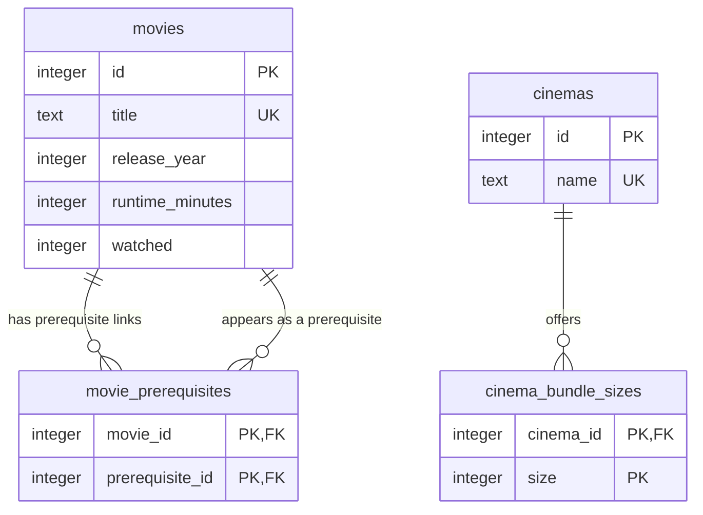

# Doomsday Ready

A full-stack app for planning an MCU rewatch and getting a cinema group-booking quote.

## Run locally

Use Node.js 24 and npm. From the project root, run:

```sh
npm ci
npm run seed
npm run dev
```

Open `http://127.0.0.1:5173` to manage your movie library. Open **Rewatch Plan** and select **Avengers: Doomsday** to see its watch order, progress, and remaining time. Vite proxies `/api` to Nest on port 3000. The API creates the local database at `data/doomsday.sqlite`.

In **Booking**, select **Sample Cinema A** and enter a group size of **6** to get two 3-seat bundles. Select **Sample Cinema D** and enter **7** to see the result when an exact quote is impossible.

Run `npm run build` to compile the API and build the React client.

`npm run seed` adds the eight movies and their prerequisite links from the assessment, plus four sample cinemas with the example bundle sizes. Rerunning it skips existing movies and cinemas by name and preserves their edits. The assessment supplies the dependency links and bundle sizes. The release year and runtime for Avengers: Doomsday are demo values.

## Run with Docker Compose

With Docker running and the Compose plugin available, run from the project root:

```sh
docker compose up --build
```

Open `http://127.0.0.1:3000`. The container serves both the React app and the API on port 3000 and seeds the sample movies and cinemas at startup. SQLite data stays in the named `doomsday-data` volume when you stop the app with `docker compose down`.

## Data model



Each prerequisite link connects a movie to another movie that must be watched first. Each bundle-size row records one seat count offered by a cinema.

## Movies API

Use `POST /api/movies` to create a movie, `GET /api/movies` to list movies, and `PATCH /api/movies/:id` to update fields. A create request requires `title`, `releaseYear`, and `runtimeMinutes`.

```json
{
  "title": "Iron Man",
  "releaseYear": 2008,
  "runtimeMinutes": 126,
  "watched": false,
  "prerequisiteIds": []
}
```

New movies default to unwatched with no prerequisites. A PATCH body can include only the fields to change. Sending `prerequisiteIds` replaces the full list, and sending an empty array clears it.

A direct or indirect prerequisite cycle returns HTTP 409 with code `CIRCULAR_DEPENDENCY`. The transaction rolls back the entire write.

`GET /api/movies/:id/rewatch-order` returns `movies` in prerequisite order, plus `watchedCount` and `remainingRuntimeMinutes`. Each prerequisite appears once. The selected movie is excluded from the list and both totals.

## Cinemas API

Use `POST /api/cinemas` to create a cinema and `GET /api/cinemas` to list cinemas. A cinema needs a unique name and 1–10 distinct integer bundle sizes from 1 to 500. Responses list bundle sizes in ascending order.

```json
{
  "name": "Example Cinema",
  "bundleSizes": [1, 3, 4]
}
```

`GET /api/cinemas/:id/booking?groupSize=6` finds the fewest bundles that seat exactly the requested group, from 1 to 10,000 people. For bundle sizes `[1, 3, 4]` and six people, it returns `{"possible":true,"bundleCount":2,"bundles":[{"size":3,"quantity":2}]}`. If no exact combination exists, the response is `{"possible":false}`. When several combinations use the same minimum number of bundles, the API returns one of them.

## How the algorithms work

- **Cycle check.** Follow the proposed prerequisites. If any path reaches the movie being edited, reject the change. A visited set keeps each movie from being checked twice.
- **Rewatch order.** Visit each prerequisite before adding the movie that needs it to the list. Leave out the target, count watched movies, and add the runtimes of the unwatched movies.
- **Booking quote.** For each seat total, save the fewest bundles and the last bundle size used. Start at zero seats with zero bundles. To fill a larger total, try adding each available size to a smaller total. Follow the saved sizes backward to build the quote.

## AI assistance

I defined the project scope, chose the tech stack, and designed and implemented the core algorithms—including prerequisite cycle detection, rewatch ordering, and minimum-bundle booking. I leveraged Codex as an AI collaborator to help plan milestones, scaffold the project structure, provide code reviews and feedback, and assist with testing and routine implementation. The data model diagram was generated using codex and was reviewed by me 
